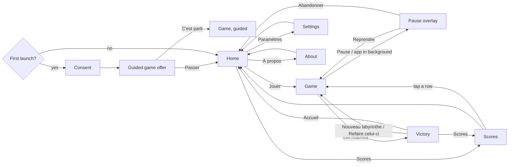

# PRD: Labyrinthe 3D

Status: approved
Project slug: labyrinthe-3d
Final app name: Labyrinthe 3D
Android package: io.github.nhilaire.labyrinthe3d
Version target: 0.1.0
Last updated: 2026-10-18 (approved by the user after the prd-reviewer pass; D5 chosen by the user; D4 amended with the user during the build; scary-mode apparitions AC-37 to AC-41 requested by the user after phone test 1)

> Written in English. Player-facing French copy is quoted in the "French copy" section.
> Status becomes `approved` only after the user explicitly approves this document.

## Summary

Labyrinthe 3D is a first-person 3D maze for Android, ported into the factory from the user's existing project
the original Maze project (local, not published) (shared JS core + Expo/expo-gl app). It is meant for the whole family and inspired by the manor maze
of The 7th Guest. The player studies the plan of a random maze, then enters it: the camera walks smoothly by itself
from one decision point to the next, and at each junction overlay arrows offer exactly the possible moves. Coloured
emblems on the walls, also drawn on the plan, are the only way to know where you are. Looking at the plan again or
turning on your footprints helps, but costs points. At the exit the plan shows your path, the shortest path and a
score out of 1000, compared with a "wall-follower" that always gets out, but badly. The fun is memory and
orientation: beat the wall-follower without getting lost. Pitch: « Mémorise le plan, puis trouve la sortie. »

**Reference rule:** this is a port, not a redesign. Every rule and number below comes from the original project's `shared/core`
and the original Maze project's `mobile/` app (local, not published) (the Android behaviour wins over the web one where they differ). The port adds what the
brief asked for: size choice, ported sound, manor mood with an optional scary mode, guided first game, haptics,
home/settings/about screens, opt-in telemetry and a 60 fps target. The only rule changes are listed in
"Deliberate deviations from the source".

## Target players

- Family: children (about 7+) and adults sharing the same phone; sideloaded APK, no store.
- Two hands, phone held in landscape, on the couch. A game lasts 1-2 min (small), 3-5 min (medium), 5-10 min
  (large).
- Accessibility: touch targets >= 48 dp; arrows carry a glyph and a text label; emblems differ by shape and colour
  (not colour alone).

## Core loop

1. Choose a size on the home screen, tap « Jouer ».
2. Memorise the plan (entrance, exit, emblems), tap to enter.
3. At each decision point, tap an arrow; the camera walks to the next decision point. Use emblems to stay oriented;
   peek at the plan or turn footprints on if lost (each costs points).
4. Reach the exit: see your path vs the shortest path, your score, the wall-follower's score and your rank.
5. « Nouveau labyrinthe » or « Refaire celui-ci » to do better.

What makes one more round tempting: beating the wall-follower, a better rating, a higher rank in the history,
replaying the same maze until it is perfect.

## Use cases

| ID | As a player I want to... | So that... |
|---|---|---|
| UC-01 | choose whether to share anonymous statistics at first launch | my privacy choice is respected |
| UC-02 | be guided through a first small maze, or skip it | I learn the rules without reading a manual |
| UC-03 | choose the maze size (small / medium / large) | children and adults each play at their level |
| UC-04 | memorise the plan, then walk the maze with arrows | I find the exit by memory and orientation |
| UC-05 | peek at the plan or show my footprints when lost | I can always get out, at a cost |
| UC-06 | see my path, the shortest path, my score and the wall-follower's | I know how well I did |
| UC-07 | browse my score history and replay any maze | I can improve on the same maze |
| UC-08 | pause, quit a maze, or have the game freeze when I leave the app | I never lose control of a game |
| UC-09 | turn sound, vibrations, the scary mode and statistics on or off | the game fits my family |
| UC-10 | read why this game exists | I know the story behind it |

## Screens

All screens are landscape, immersive fullscreen (system bars hidden; an edge swipe brings them back temporarily),
dark manor palette.

- **Consent** (first launch only; reachable again from Settings): explains the anonymous statistics in French, two
  buttons of equal size and prominence (« Accepter » / « Refuser »). The game is fully playable either way.
- **Guided game offer** (first launch, after consent): « Première partie guidée ? » with « C'est parti » and
  « Passer ». Either choice marks the offer as done; it is never shown again automatically.
- **Home:** title « Labyrinthe 3D », pitch line, size selector (Petit 8 × 6 / Moyen 14 × 9 / Grand 20 × 12, the last
  choice is remembered, default Moyen), « Jouer », « Scores », « Paramètres », « À propos ».
- **Game:** full-screen 3D view. HUD chips at the top left: steps (« 12 pas »), « Plan (n) −8 % », « Traces (n)
  −12 % » (highlighted while on), « Pause ». Arrows at fixed places: forward top centre, left on the left, right on
  the right, U-turn bottom centre; each with a glyph (↑ ↰ ↱ ↩) and a label. Arrows are shown only in the choosing
  phase. Overlays: intro plan, peek plan, pause, victory, and in the guided game the guide bubbles.
- **Plan overlay** (intro and peek): paper-coloured plan with walls, « ENTRÉE » and « SORTIE » markers, the emblems;
  during a peek also the player's position and heading. Title and hint per the French copy. A tap anywhere closes it.
- **Pause overlay:** « Pause », « Reprendre », « Abandonner ». The game is frozen behind it.
- **Victory:** « N points · rating », the plan with the walked path (red, darker when walked several times), the
  shortest path (blue) and the walls, a line « S pas pour O au mieux · D choix · aides −P % / sans aide · Suiveur de
  murs : B pts » plus the rank, buttons « Nouveau labyrinthe », « Refaire celui-ci », « Scores », « Accueil ».
- **Scores:** history, best first, 20 rows shown: rank, points, rating, steps (with ratio ×steps/optimal), aid
  penalty or « — », size « W×H », replay glyph ↻. Tap a row to replay that maze. « Fermer », « Effacer
  l'historique » (needs a second tap « Confirmer ? »). Empty state text.
- **Settings:** toggles « Son », « Vibrations », « Mode frisson », « Statistiques anonymes »; button « Rejouer la
  partie guidée »; « Retour ».
- **About:** « Pourquoi ce jeu » (the story, `about.story`), « Ce jeu » (made by a passionate independent developer,
  inspired by The 7th Guest and not affiliated with its authors), « Fait avec » (React Native, Expo, Three.js), the
  app version, « Retour ».

## Rules and scoring

The game logic is the source `shared/core`, converted to pure TypeScript with the same algorithms and constants,
unit-tested with fixed seeds. Coordinates: x to the right, y down; directions 0 = N (y−1), 1 = E, 2 = S, 3 = W.

### Generation

- PRNG mulberry32 (`makeRng(seed)`), seed = random uint32 for a new game.
- Sizes: small 8 × 6, medium 14 × 9, large 20 × 12 (width × height in cells).
- Recursive backtracker from a random start cell; at each step, if the previous direction is still possible, it is
  kept with probability `straightness = 0.7`, otherwise a random unvisited neighbour is chosen. `braidRatio = 0`
  (perfect maze: one path between two cells).
- Entrance and exit are carved on two different borders drawn at random; the entrance cell is random on its border;
  the exit is drawn among the cells of the other border whose distance from the entrance is >= 90 % of the farthest
  one on that border.
- Validation (BFS): solvable and every cell reachable, always. Quality: solution length >= `round(W × H × 0.33)` and
  spread (min of row coverage, column coverage of the solution) >= 0.7. Up to 40 attempts, attempt k uses seed
  `seed + (k−1) × 0x9e3779b1`; quality thresholds relax linearly to 0 over the first 75 % of attempts. The game keeps
  the seed of the accepted attempt.
- Replay (deviation D1): replaying a recorded maze rebuilds it from the stored accepted seed with the same carving
  steps and **no quality check**, so the walls are always identical to the recorded game.

### Landmarks (emblems)

- 10 distinct emblems (shape + colour). Target count `max(3, min(10, round(W × H / 26)))`: 3 (small), 5 (medium),
  9 (large).
- Candidates exclude the entrance and exit cells: junctions (3+ openings) first, then dead ends, each list shuffled
  with `makeRng(seed ^ 0x9e3779b9)`; picked greedily with a Manhattan spacing of 5, relaxed by 1 down to 0 until the
  target is reached. Emblem i = index mod 10. The emblem is on the back wall of a dead end, or the first wall (N, E,
  S, W order) of a junction.

### Navigation

- The player starts outside the entrance, facing in. After the intro plan, the walk into the maze is automatic.
- At a decision point, offered moves: forward, left, right when passable; U-turn **only** when none of them is
  (dead end).
- After a choice, the route is followed automatically through corridors (one way on), corners included, until a
  junction (2+ ways on), a dead end, or the exit is crossed. Each cell entered counts 1 step.
- Arrows are hidden and taps ignored while walking and while any overlay is open.
- The camera turns in place, rounds corners and slows down in curves (source `walker.js` profile).

### Helps

- Intro plan: free; taps are ignored during its first 3 s, then it stays until the player taps (deviation D5).
- « Plan » (peek): allowed while choosing or walking; each opening costs 8 %; shows the player's cell and heading;
  the game is frozen (camera stops even mid-corridor and resumes exactly from there) until a tap; tapping « Plan »
  again closes it at no cost.
- « Traces »: toggles footprints on the floor (always recorded, so turning them on late shows the whole history,
  brighter where walked several times); each activation costs 12 %, turning off is free; not available while a plan
  is open.

### Score

- `optimalSteps = solutionLength + 1` (from outside the entrance to outside the exit).
- `efficiency = min(1, optimalSteps / steps)`, `aid = max(0, 1 − 0.08 × peeks − 0.12 × traces)`,
  `points = max(0, round(1000 × efficiency × aid))`.
- Ratings: >= 900 « Sans faute », >= 750 « Excellent », >= 600 « Très bon », >= 450 « Correct », >= 300
  « Laborieux », else « Sorti par hasard ».
- Aid penalty shown = `min(100, round((0.08 × peeks + 0.12 × traces) × 100))` %.
- Wall-follower baseline: left-hand rule played with the same move constraints (priority left, forward, right,
  U-turn), from the same start; its score uses the same formula with no aid. Shown on the victory screen.

### Persistence (local only)

- Score history: one record per completed non-guided game {id, at, points, rating, steps, optimalSteps, decisions,
  peeks, traces, seed, width, height}; sorted by points desc then most recent; kept to 100 entries. The victory
  screen shows the rank (« Meilleur score ! » when 1st, else « {rank}e sur {total} »); a record that is not kept
  (lower than all 100 kept entries) shows no rank line.
- Settings (sound, haptics, scary mode, telemetry consent), last chosen size, guided-game-offer done flag.
- An abandoned game (Pause > Abandonner) is not recorded. When the app goes to the background the game freezes; on
  return the pause overlay is shown if a game was in progress and no plan overlay was open (an open plan stays as
  it was).

### Guided first game

- Small maze with a **fixed seed** (the same tutorial maze for everyone, chosen during the build among seeds whose
  solution has at least 2 decision points), normal rules, score not recorded. A « Passer » button stays visible top
  right; it ends the guided game and goes to Home.
- Its victory screen shows the score, the plans and the bubble `guide.score`, with a single button « Accueil »
  (no « Refaire celui-ci » nor « Scores »).
- Bubbles, each closed by a tap (the game is frozen while a bubble is shown):
  1. on the intro plan: `guide.plan`;
  2. at the first decision point: `guide.arrows`;
  3. at the second decision point: `guide.helps`;
  4. on the victory screen: `guide.score`.
- Settings > « Rejouer la partie guidée » starts it again.

### Deliberate deviations from the source

- D1: replay rebuilds the stored maze without the quality check (the source regenerated from the accepted seed with
  attempt-1 thresholds, which could produce a different maze when the original was accepted after relaxation).
- D2: player-facing text uses « tu » (the source used « vous ») and the plan markers read « ENTRÉE » / « SORTIE »
  (source: « IN » / « OUT »).
- D3: the maze size is chosen on the home screen (source: fixed 14 × 9 on Android).
- D4: a testing deep link `labyrinthe3d://play?size=<small|medium|large>&seed=<uint32>` starts a game on a given
  maze, for the Maestro flows. It stays in release builds (the flows run on the signed release APK); it is harmless:
  it only starts a normal game on that maze (amended with the user on 2026-10-18, as in Loto Quine).
- D5: taps on the intro plan are ignored during its first 3 s (as on the web version; the Android source closed it on
  the first tap), so a child cannot skip it by accident.

## Look, sound and feel

- **Manor mood (default):** dark manor corridors with warm candle-like torch light that flickers gently, wood and
  stone procedural textures painted in code (no image asset from The 7th Guest or elsewhere), exponential fog, warm
  lights at the entrance and exit, emblem plaques on the walls. Slightly eerie, never frightening.
- **Mode frisson (setting, off by default):** fog density × 1.8, torch intensity × 0.65 with a stronger flicker,
  colder wall tint, ambience drone one octave lower with an occasional distant creak (every 20-40 s, random). Same
  rules and score.
- **Apparitions in « Mode frisson »** (amendment requested by the user after phone test 1; decor only, never in the
  manor mood): procedural, no image asset, no sudden jump scare.
  - Every 10 to 20 s of active play (uniform random; the clock stops while a plan, the pause or a bubble is shown),
    one apparition among: a **ghostly shadow** (a pale translucent hooded silhouette that glides across the corridor
    ahead or at its far end, fades in and out, about 2.5 s), a **spider** (a small black spider that comes down on its
    thread from the ceiling a little ahead, hangs, then climbs back, about 3 s), a **candle that dims** (the torch
    drops to about a third with a strong flicker for about 1.2 s, then recovers).
  - Ghosts and spiders appear only in open cells in sight of the player (no wall between), never inside a wall.
  - **Cobwebs**: static webs in the upper corners of about 15 % of the corner and dead-end cells, chosen from the maze
    seed (same maze, same webs).
  - Apparitions change nothing in the rules, the score, the moves or the telemetry.
- **Sound** (ported from the web WebAudio design, rendered offline to small audio files bundled with the app):
  looping ambience drone; footsteps triggered by the real walk cadence (slower in curves); a whoosh on turns; a click
  on arrows and buttons; a chime when passing an emblem; a chord at the exit. « Son » off mutes everything.
- **Haptics** (« Vibrations », on by default): light impact on an arrow tap, success notification at the exit.
- **Performance:** steady 60 fps while walking and turning; textures and geometry built once per maze; no React
  re-render per frame (the render loop lives outside React).
- Orientation: landscape only; screen kept awake during a game.

## Telemetry events

Only events listed here may be sent (after consent). Params: numbers, booleans or short enums. No identifiers.
`size` ∈ {small, medium, large}.

| Event | When | Params | Feeds KPI |
|---|---|---|---|
| game_start | the player enters a maze (intro plan closed) | size, replay (bool), guided (bool), scary (bool) | Completion rate, Scary mode adoption |
| game_complete | exit reached | size, guided, points, steps_ratio (steps/optimal, 2 decimals), peeks, traces, beat_follower (bool: points > wall-follower points; a tie is not a win), duration_s | Completion rate, Score vs wall-follower, Help usage |
| game_abandon | Pause > Abandonner, or « Passer » in the guided game, **only if game_start was sent for this game** | size, guided, duration_s | Completion rate |
| perf_sample | at game_complete or game_abandon, if >= 300 frames were drawn while walking | size, fps_avg, slow_frames_pct (frames > 20 ms, %), scary (bool) | Smoothness |
| tutorial_end | guided victory screen shown, or guided game skipped (offer « Passer » or in-game « Passer ») | skipped (bool) | Tutorial completion |
| settings_change | the « Mode frisson » toggle changes | setting = scary, value ∈ {on, off} | Scary mode adoption |

## KPIs

Business and technical indicators followed in Firebase (free Spark plan). Details and console paths in `docs/KPIS.md`.

| KPI | Type | Target | Source |
|---|---|---|---|
| Completion rate per size | business | >= 70 % (small), >= 50 % (large) | game_complete / game_start by size, guided = false |
| Score vs wall-follower | business | >= 50 % of games | share of game_complete (guided = false) with beat_follower = true |
| Help usage | business | tracked (no target) | game_complete peeks, traces |
| Tutorial completion | business | tracked (no target) | tutorial_end skipped |
| D1 / D7 retention | business | D1 >= 30 % | Analytics > Retention |
| Scary mode adoption | business | tracked (no target) | share of game_start with scary = true; settings_change |
| Smoothness | technical | fps_avg >= 55, slow_frames_pct <= 5 % | perf_sample |
| Crash-free users | technical | >= 99 % | Crashlytics |
| Cold start, APK size | technical | < 3 s, < 40 MB | evidence reports |

## Non-functional requirements

- Performance: steady 60 fps while walking and turning on the user's phone (see AC-30); a new maze (any size) is
  ready less than 1 s after « Jouer »; cold start < 3 s.
- APK size (arm64): target < 40 MB.
- Works fully offline. No account. No ads.
- Android only; landscape only; minSdk from the stack defaults.
- Privacy: opt-in telemetry, no personal data, AD_ID permission removed.

## Acceptance criteria

Each criterion is testable and tagged with its proof: `[unit]` Jest, `[e2e]` Maestro flow, `[device]` check on the
phone, `[manual]` human judgement (keep these rare).

Consent and first launch
- AC-01 [e2e] Given a first launch, when the app opens, then the consent screen is shown in French with « Accepter »
  and « Refuser » of equal size.
- AC-02 [e2e] Given the consent screen, when the player taps either button, then the guided game offer is shown, and
  after « Passer » the home screen is shown; on the next launch neither consent nor the offer is shown.
- AC-03 [unit] Given telemetry consent refused, unset, or turned off in Settings, when any game event happens, then
  Analytics and Crashlytics collection are disabled and nothing is sent; given consent accepted, both are enabled and
  the events of the table are sent with only the listed params (game_abandon only after a game_start of the same
  game).

Generation and landmarks
- AC-04 [unit] Given 200 seeds for each size, when a maze is generated, then it is solvable, every cell is
  reachable, the entrance and exit are on two different borders, and the exit's distance is >= 90 % of the farthest
  cell of its border.
- AC-05 [unit] Given the same seed and size, when the maze is generated twice, then walls, entrance, exit and
  landmarks are identical; and the TypeScript generator reproduces the source JS output for 20 reference seeds.
- AC-06 [unit] Given a recorded game whose maze was accepted after relaxation, when it is replayed from its stored
  seed, then the walls are identical to the recorded maze (D1).
- AC-07 [unit] Given each size, when landmarks are picked, then their count is 3, 5 and 9, none is on the entrance or
  exit cell, and each sits on a wall of its cell.

Navigation
- AC-08 [unit] Given a cell and a facing, when moves are listed, then forward/left/right appear exactly when passable,
  and U-turn appears only when none of them is passable.
- AC-09 [unit] Given a chosen direction, when the route is planned, then it stops at the first junction, dead end or
  exit crossing, follows corners, and the step count grows by the number of cells entered.
- AC-10 [unit] Given 200 seeds, when the camera walker follows any planned route, then it never crosses a wall and
  ends on the route's last cell facing its end direction.
- AC-11 [e2e] Given a game on a known small maze (testing deep link, D4), when the player taps the offered arrows along the shortest path,
  then the victory screen appears with « 1000 points · Sans faute ».
- AC-12 [e2e] Given the walk in progress, when the camera is moving, then no arrow is shown; at a decision point the
  arrows shown match the passable moves.

Helps
- AC-13 [unit] Given a game, when « Plan » is opened 2 times and « Traces » is activated once and deactivated once,
  then peeks = 2 and traces = 1.
- AC-14 [e2e] Given the player is walking, when « Plan » is tapped, then the plan shows the player's position, the
  step counter does not change while it is open, and a tap closes it.
- AC-15 [e2e] Given footprints are off, when « Traces » is tapped, then the chip is highlighted and its counter shows
  (1).

Score and end
- AC-16 [unit] Given optimalSteps, steps, peeks and traces, when the score is computed, then it matches the formula
  and rating thresholds (cases: perfect path = 1000; steps = 2 × optimal = 500; 2 peeks + 1 trace on a perfect path
  = 720; aid floor at 0).
- AC-17 [unit] Given 100 seeds per size, when the wall-follower plays, then it always exits with the player's move
  constraints, and its score uses the same formula.
- AC-18 [e2e] Given the exit is reached, when the victory screen shows, then it displays points, rating, steps vs
  optimal, choices, aid penalty or « sans aide », the wall-follower's points, the rank, the walked and shortest paths,
  and the four buttons.

Persistence and replay
- AC-19 [unit] Given 105 completed games, when they are saved, then the history keeps the 100 best (points desc,
  most recent first on ties) and returns the new record's rank and total; given 100 kept entries and a new score
  lower than all of them, the record is not kept and no rank is returned (no rank line on the victory screen).
- AC-20 [e2e] Given a completed game, when the app is restarted and Scores is opened, then the game is listed; when
  its row is tapped, then a game starts with the same size and the same maze.
- AC-21 [e2e] Given a non-empty history, when « Effacer l'historique » then « Confirmer ? » are tapped, then the
  empty-state text is shown.
- AC-22 [e2e] Given « Grand » is selected on Home, when the app is restarted, then « Grand » is still selected and
  « Jouer » starts a 20 × 12 maze.

Pause and lifecycle
- AC-23 [e2e] Given a game in progress, when « Pause » then « Abandonner » are tapped, then Home is shown and the
  game is not in the history.
- AC-24 [device] Given a game while walking, when the app goes to the background and comes back, then the pause
  overlay is shown and the camera resumes from the same place after « Reprendre ».

Guided game
- AC-25 [e2e] Given the guided game, when it is played to the exit, then the four bubbles appear in order (plan,
  arrows, helps, score), the victory screen shows only « Accueil », and the game is not recorded in the history.
- AC-26 [e2e] Given the guided game, when « Passer » is tapped, then Home is shown; Settings > « Rejouer la partie
  guidée » starts it again.

Settings, sound, look
- AC-27 [unit] Given the settings store, when each toggle (sound, haptics, scary, telemetry) changes, then the value
  persists across reloads, and the defaults are sound on, haptics on, scary off.
- AC-34 [unit] Given « Vibrations » on, when an arrow is tapped then a light impact is triggered, and when the exit is
  reached then a success notification is triggered; given « Vibrations » off, no haptic call is made (mocked
  haptics adapter).
- AC-28 [device] Given sound on, when playing, then the drone, footsteps, turn whoosh, arrow click, emblem chime and
  exit chord are heard; given « Son » off, then nothing is heard.
- AC-29 [manual] Given the default mood, the corridors feel like a mysterious manor and are fine for children; given
  « Mode frisson » on, the maze is visibly darker and the ambience scarier.

Performance and stability
- AC-30 [device] Given a release build on the user's phone, when a large maze is walked for 60 s (normal and scary
  mode), then the logged frame stats show fps_avg >= 55 and slow_frames_pct <= 5 %.
- AC-31 [device] Given a release build, when « Jouer » is tapped with « Grand », then the intro plan is shown in
  less than 1 s (logged timing).
- AC-32 [device] Given a release build, cold start is < 3 s and no crash or ANR appears in logcat during the Maestro
  flows.

About
- AC-33 [e2e] Given Home, when « À propos » is tapped, then the story text `about.story` is shown verbatim, with the
  « passionate independent developer » mention, the non-affiliation with The 7th Guest and the app version.
- AC-36 [unit] Given the intro plan has just opened, when the player taps before 3 s, then it stays open; when the
  player taps after 3 s, then the walk into the maze starts (D5).
- AC-35 [unit] Given `src/i18n/fr.ts`, then no plain space precedes `:`, `;`, `!`, `?` or `%`, nor follows `«` or
  precedes `»` (French typography with no-break spaces).

Scary-mode apparitions (amendment after phone test 1)
- AC-37 [unit] Given « Mode frisson » on and a game running, when active time passes, then an apparition (ghost,
  spider or candle) starts every 10 to 20 s of active time, all three kinds occur, none starts while the game is
  frozen (plan, pause, bubble), and none ever starts with « Mode frisson » off.
- AC-38 [unit] Given 200 seeds and every decision point of their shortest path, when a ghost or a spider is placed,
  then its cell is open, inside the maze, in the corridor in front of the player with no wall between, and its path
  never crosses a wall.
- AC-39 [unit] Given a maze and its seed, cobwebs are on about 15 % (10 to 20 %) of the corner and dead-end cells,
  the same for the same seed, each in an upper corner touching two walls; none is built in the manor mood.
- AC-40 [unit] Given a game played with apparitions running, then steps, moves, score and telemetry events are the
  same as without them.
- AC-41 [manual] Given « Mode frisson » on the phone, the ghosts, spiders, cobwebs and dimming candle are visible and
  eerie but fine for a family (no jump scare), and the walk stays smooth (fps_avg >= 55, slow frames <= 5 %).

## French copy

Tone: « tu ». In `fr.ts`, the spaces before `:` and `%` and inside « » are U+00A0, and before `!`, `?`, `;` are
U+202F (shown as plain spaces below).

| Key | French text |
|---|---|
| consent.title | Statistiques anonymes |
| consent.body | Pour améliorer le jeu, tu peux partager des statistiques anonymes (parties jouées, scores, plantages). Aucune donnée personnelle, aucune publicité. Tu pourras changer d'avis dans les Paramètres. |
| consent.accept | Accepter |
| consent.refuse | Refuser |
| guideOffer.title | Première partie guidée ? |
| guideOffer.body | Un petit labyrinthe pour apprendre à jouer, en quelques bulles. |
| guideOffer.go | C'est parti |
| guideOffer.skip | Passer |
| home.title | Labyrinthe 3D |
| home.pitch | Mémorise le plan, puis trouve la sortie. |
| home.size.small | Petit 8 × 6 |
| home.size.medium | Moyen 14 × 9 |
| home.size.large | Grand 20 × 12 |
| home.play | Jouer |
| home.scores | Scores |
| home.settings | Paramètres |
| home.about | À propos |
| hud.steps | {n} pas |
| hud.plan | Plan{ (n)} −8 % |
| hud.traces | Traces{ (n)} −12 % |
| hud.pause | Pause |
| move.forward | Tout droit |
| move.left | À gauche |
| move.right | À droite |
| move.back | Demi-tour |
| plan.introTitle | Mémorise le plan |
| plan.introHint | Touche l'écran pour entrer dans le labyrinthe |
| plan.peekTitle | Plan |
| plan.peekHint | Touche l'écran pour reprendre (ce coup d'œil coûte 8 % du score) |
| plan.entrance | ENTRÉE |
| plan.exit | SORTIE |
| pause.title | Pause |
| pause.resume | Reprendre |
| pause.quit | Abandonner |
| victory.title | {points} points · {rating} |
| victory.line | {steps} pas pour {optimal} au mieux · {decisions} choix · {aid} · Suiveur de murs : {baseline} pts |
| victory.noAid | sans aide |
| victory.aid | aides −{p} % |
| victory.best | Meilleur score ! |
| victory.rank | {rank}e sur {total} |
| victory.new | Nouveau labyrinthe |
| victory.again | Refaire celui-ci |
| victory.scores | Scores |
| victory.home | Accueil |
| rating.900 | Sans faute |
| rating.750 | Excellent |
| rating.600 | Très bon |
| rating.450 | Correct |
| rating.300 | Laborieux |
| rating.0 | Sorti par hasard |
| scores.title | Meilleurs scores |
| scores.empty | Aucune partie enregistrée pour le moment. |
| scores.hint | Touche une ligne pour rejouer ce labyrinthe. |
| scores.close | Fermer |
| scores.clear | Effacer l'historique |
| scores.confirm | Confirmer ? |
| settings.title | Paramètres |
| settings.sound | Son |
| settings.haptics | Vibrations |
| settings.scary | Mode frisson |
| settings.scaryHint | Plus sombre, plus inquiétant. Déconseillé aux plus jeunes. |
| settings.telemetry | Statistiques anonymes |
| settings.replayGuide | Rejouer la partie guidée |
| common.back | Retour |
| guide.skip | Passer |
| guide.plan | Mémorise bien ce plan : tu entres par ENTRÉE et tu dois trouver la SORTIE. Les symboles de couleur sont gravés sur les murs : ils t'aideront à savoir où tu es. |
| guide.arrows | À chaque croisement, touche une flèche. Tu avances tout seul jusqu'au croisement suivant. |
| guide.helps | Perdu ? « Plan » remontre le plan avec ta position (−8 %). « Traces » montre où tu es déjà passé (−12 %). |
| guide.score | Moins de pas et moins d'aide, c'est plus de points. Essaie de battre le suiveur de murs ! |
| about.title | À propos |
| about.whyTitle | Pourquoi ce jeu |
| about.story | Enfant, j'ai recopié ligne à ligne en GFA Basic un petit jeu de labyrinthe sur mon Atari ST : un de mes premiers programmes. Quelques années plus tard, le labyrinthe du manoir de The 7th Guest m'a fait frissonner. J'ai créé ce jeu pour réunir ces deux souvenirs et les partager en famille. |
| about.gameTitle | Ce jeu |
| about.game | Créé par un développeur indépendant passionné. Inspiré de The 7th Guest, sans lien avec ses auteurs. |
| about.builtWith | Fait avec React Native, Expo et Three.js |
| about.version | Version {version} |

## Out of scope

- Online leaderboard (scores stay on the phone), accounts, ads, in-app purchases.
- Web and iOS versions (Android only).
- Daily maze (same seed for everyone).
- Inner-exit mode that defeats the wall-follower.
- Braided mazes (loops), custom sizes or walk-speed settings (source URL parameters).
- Keyboard controls (web only).

## Open questions

None
